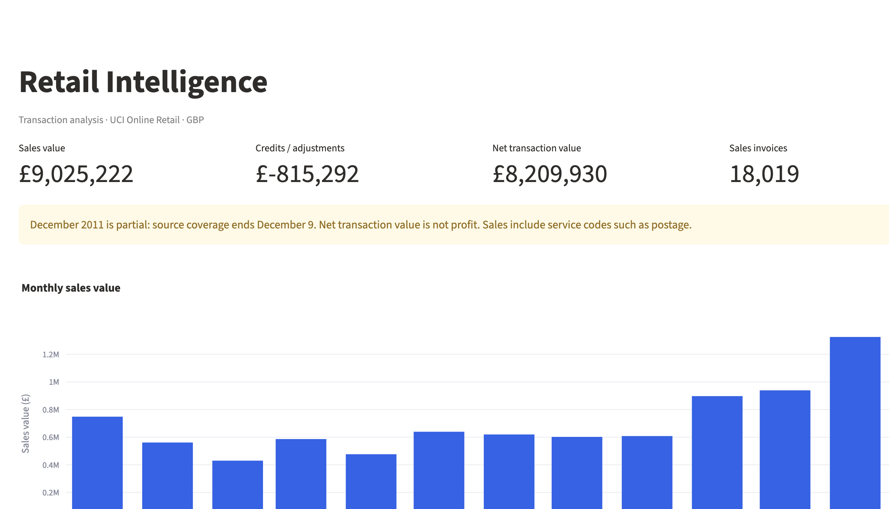
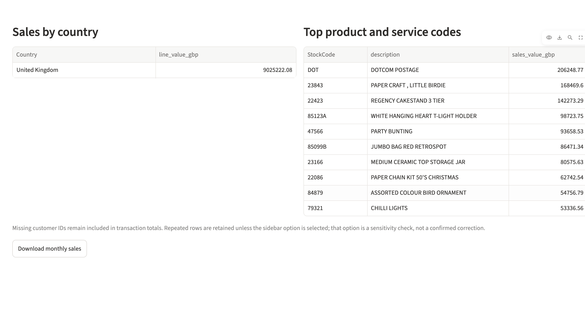
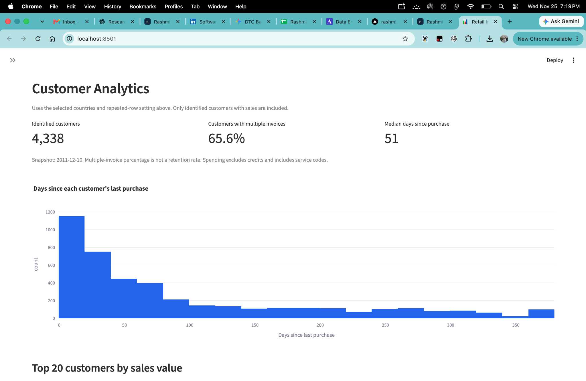
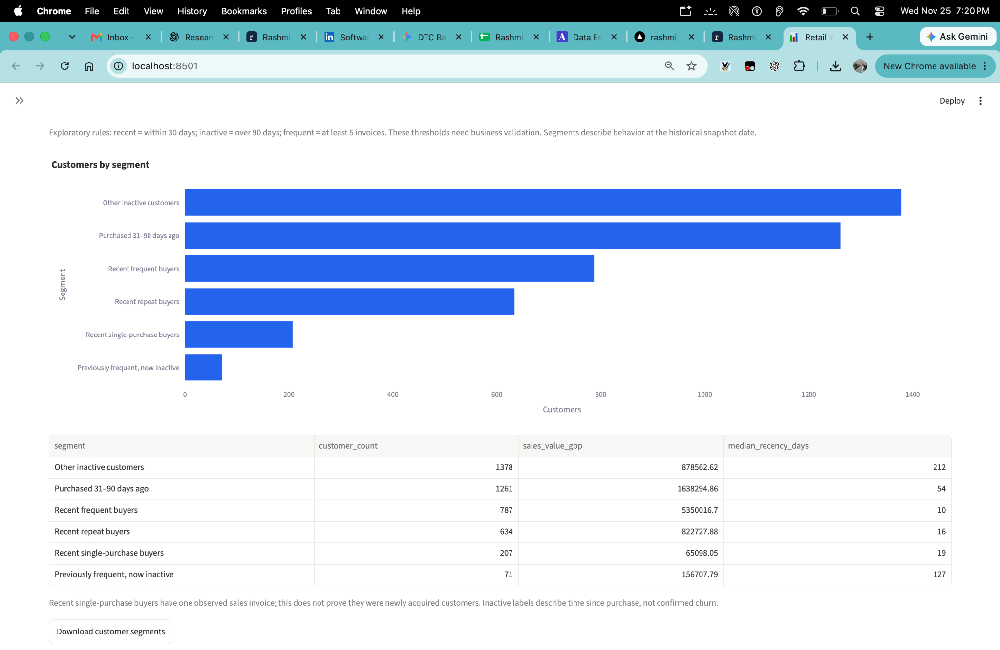
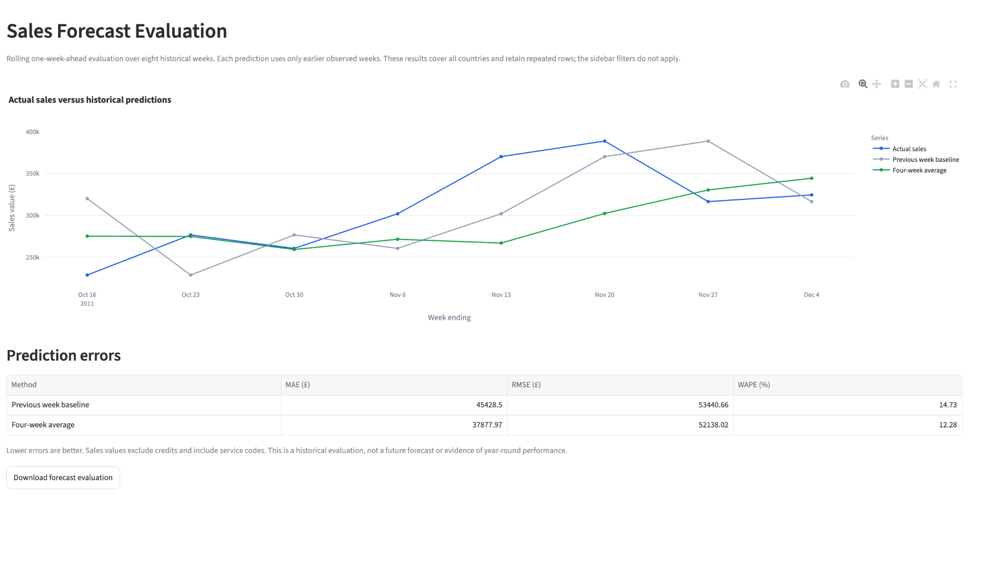

# Retail Intelligence

A retail data analysis pipeline and interactive dashboard built with
Python, Pandas, Streamlit, and Plotly.

## Features

- Processes 541,909 source transaction rows.
- Reports missing values, repeated rows, and invalid prices.
- Separates sales, credits/adjustments, and rows requiring review.
- Analyzes monthly sales, countries, and product/service codes.
- Provides country filters and downloadable monthly reports.

## Dashboard





## Run locally

Requires Python 3.10 or newer.

```bash
python3 -m venv .venv
source .venv/bin/activate
python -m pip install -r requirements.txt
```

Download the UCI Online Retail dataset:
https://archive.ics.uci.edu/dataset/352/online+retail

Extract `Online Retail.xlsx` into `data/raw/`, then run:

```bash
python prepare_data.py
python analyze_sales.py
python -m streamlit run dashboard.py
```

## Analysis notes

- Data coverage ends December 9, 2011; that month is incomplete.
- Net transaction value is not profit.
- Sales include service codes such as postage.
- Missing customer IDs remain included in transaction totals.
- Repeated rows are flagged and retained by default.
- The duplicate-exclusion option is a sensitivity check.

## Project files

- `prepare_data.py`: preparation and data-quality reporting.
- `analyze_sales.py`: monthly, country, and product reports.
- `dashboard.py`: interactive Streamlit dashboard.
- `reports/`: generated analysis outputs.
## Customer Analytics

Customer purchase recency, invoice frequency, sales value, and
six exploratory business-rule segments, evaluated at December 10, 2011.




## Run the pipeline

After placing Online Retail.xlsx in data/raw/:

```bash
python run_pipeline.py
python -m streamlit run dashboard.py
## Sales Forecast Evaluation

Compared a previous-week baseline with a four-week moving average
using rolling one-week-ahead evaluation over eight historical weeks.

The four-week average achieved £37,877.97 MAE and 12.28% WAPE,
with approximately 16.6% lower MAE than the baseline.

Results cover all countries, retain flagged repeated rows,
and measure sales before credits, including service codes.


## Author

Rashmi Thimmaraju